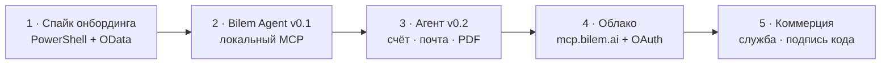

## Сейчас: первая публичная бета (решение Славы 22.10.2026)

**Статус:** принято · облако работает целиком: кабинет, подключение баз кодом, WhatsApp на общем номере (с голосовыми), ChatGPT подан в каталог.

1. **Релиз.** Первая публичная бета Bilem Agent выходит обычным релизом GitHub (не prerelease) в `skp-kz/bilem.ai`, чтобы `releases/latest` и `bilem.ai/download` отдавали её напрямую. Две ветки (stable и beta) пока не делаем, галочку «получать бета-обновления» в агенте оставляем. Задача Земле — карточка stand #65.
2. **Один номер WhatsApp на всех.** Агент узнаёт человека по номеру из списка «Люди» его организации. Чужих данных не отдаёт: ключ к Meta только в облаке, незнакомцам — одно приветствие без доступа к данным.
3. **Бета-тестеры подключаются сами через кабинет** app.bilem.ai: регистрация, потом своя или тестовая база. Первые — бухгалтеры:
   - Дарья: регистрация в кабинете, база на её сервере (доступ у СКП есть);
   - Инна: вместо OpenClaw — кабинет и WhatsApp, подключаем тестовую базу;
   - Анастасия (облачный провайдер): пока бета-тестер и источник запросов от бухгалтеров; шлюз провайдера в Docker и CFE — в разработке (направление «Партнёры», Станислав);
   - Саша Шевченко и другие — собираем группу бета-тестеров.
4. **MCP растёт по запросам, а не пачками.** Новый инструмент — только когда его просит живой бухгалтер или директор: взвешиваем (здравый или нет), делаем, проверяем на базе. Ночных пачек по 60 карточек больше нет. Активное тестирование — ориентировочно 2–3 месяца. См. [Что умеет Bilem Agent](/product/menu-uslug).
5. **Объявления.** Выход первого релиза — новостью на bilem.ai («вышла первая публичная бета, можно скачать»). Новые инструменты — в заметках к релизам. Видео «как подключить» — на YouTube-канале Славы (не отдельный канал), с тегами и заголовками Bilem.

**Отложили:** отдельный номер WhatsApp на клиента (не нужен); две ветки релизов; каталог Claude — только после OpenAI, по очереди; единые демо-данные для WhatsApp и MCP.

**Кто что делает:** Земля — релиз #65, Слава мержит, проверка `bilem.ai/download/info` (channel=stable). Воздух — новость о релизе на bilem.ai, запросы бета-тестеров карточками на Стенде. Слава — в пятницу вечером пишет Дарье, Инне и Анастасии, собирает группу бета-тестеров.

## «Разрешить СКП подключать мои базы» (решение Славы 22.10.2026)

**Статус:** принято · задача Воздуху — stand #66 · макет `docs/mockups/bilem-trusted-partner.html` (репо minidesk; из макета берём тумблер и подтверждение в WhatsApp, режима «без вопросов» нет).

Сервисная компания подключает базу клиента **без пароля клиента**. Показывает наше качество обслуживания.

1. **Один тумблер на стороне клиента.** Кабинет → Настройки → «Разрешить СКП подключать мои базы» (сотрудники СКП будут видеть ваш кабинет только для чтения и смогут отправлять запросы на подключение баз). Рядом ссылка на СКП. Отдельного подтверждения входа нет, срока нет: тумблер включён, пока клиент его не выключит.
2. **Выключен — СКП не видит ничего.** Это частная территория клиента.
3. **Включён — сотрудники СКП входят своими аккаунтами SKP ID**, видят кабинет только для чтения и отправляют запрос на подключение базы с сервера, который обслуживают.
4. **Каждую базу владелец подтверждает в WhatsApp:** «Сотрудники СКП хотят подключить вашу базу „…“ (организация, БИН, сервер). Подтверждаете подключение?» → «Да» → «База подключена». Без «Да» база не подключается.
5. **Проверка БИН:** подключить можно только базу, где БИН совпадает с организацией клиента. Всё — в журнал (кто, когда, сервер, база).

**Этапы:** 1) заглушка тумблера в Настройках; 2) роль партнёра (только чтение + запросы), сообщение WhatsApp с кнопкой, журнал; 3) репетиция со Славой: номер жены Славы как владелец демо-аккаунта; потом — Дарья. Та же роль позже — для облачных провайдеров (направление «Партнёры»).

**Открыто:** видит ли СКП переписку с агентом и память (предложение — нет), уточнить на репетиции.

---

<Note>
  Ниже — план от 17.10.2026 по решению [0009 · OData + Bilem Agent вместо cfe](/decisions/0009-odata-agent-vmesto-cfe). Шаги 1–4 к 22.10 пройдены, сейчас идёт публичная бета (выше).
</Note>

<Steps>
  <Step title="1 · Спайк онбординга" icon="flask">
    Земля гоняет `setup-spike.ps1` на копиях эталонной учебной базы: вход админом через COM → пользователь `bilem` → состав OData → публикация `webinst` на IIS только для 127.0.0.1 → проверка `$metadata`. Всё, что понадобилось, — в скрипт, не руками. Задача: [Спайк онбординга](/stand/agent-spike).

    **Готово, когда:** с новой копии эталона скрипт проходит до «ГОТОВО» без ручных правок, OData отвечает под `bilem` только с 127.0.0.1.
  </Step>
  <Step title="2 · Bilem Agent v0.1 — бесплатный локальный MCP" icon="desktop">
    Windows-программа (вариант A: классическое окно). Шаги спайка внутри мастера: выбрать базу → пароль админа → «Подключить». Локальный MCP с токеном и белым списком IP, инструменты `whoami`, `cash_balance`, `debtors` (сверка с cfe на той же базе), журнал, проверка доступа после обновления 1С. Кнопки «Подключить к Claude Code / Claude Desktop / Cursor».

    **Готово, когда:** ролик «три шага — и ИИ отвечает по 1С» снимается на чистой машине.
  </Step>
  <Step title="3 · Агент v0.2 — запись и документы" icon="file-invoice">
    Черновик счёта и доверенности через OData по рецепту Куралай → кнопка «Подтвердить» мимо модели → PDF своим шаблоном с логотипом → отправка по SMTP клиента.
  </Step>
  <Step title="4 · Облако" icon="cloud">
    Режим «Облако bilem» в той же программе: исходящее соединение к `mcp.bilem.ai`, OAuth (Auth0, тот же вход, что в кабинет) → ChatGPT, claude.ai, голос, Telegram/WhatsApp.

    **Первый пилот:** Зимин (сыроварня).
  </Step>
  <Step title="5 · Коммерция" icon="handshake">
    Служба Windows (работа без открытого окна), MSI, самообновление, подпись кода, права по людям и несколько баз по тарифу.
  </Step>
</Steps>

<Note>
  `bilem.cfe` заморожен: эталон для сверки ответов. Кабинет `app.bilem.ai` и каналы развиваются параллельно и подключатся к агенту по тому же контракту инструментов.
</Note>
